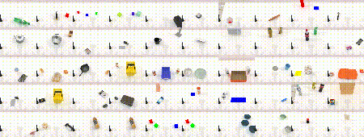
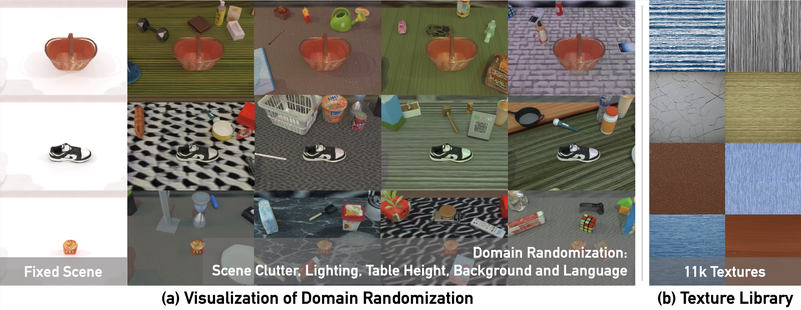

<h1 align="center">
  <a href="https://robotwin-benchmark.github.io"><b>RoboTwin</b> 双臂机器人操作平台<br></a>
</h1>
<h2 align="center">最新版本：RoboTwin 2.0<br>🤲 <a href="https://robotwin-platform.github.io/">主页</a> | <a href="https://robotwin-platform.github.io/doc/">文档</a> | <a href="https://arxiv.org/abs/2506.18088">论文</a> | <a href="https://robotwin-platform.github.io/doc/community/index.html">社区</a> | <a href="https://robotwin-platform.github.io/leaderboard">排行榜</a></h2>

https://private-user-images.githubusercontent.com/88101805/463126988-e3ba1575-4411-4a36-ad65-f0b2f49890c3.mp4

**RoboTwin 2.0**（*ICML 2026*）— [主页](https://robotwin-platform.github.io/) · [文档](https://robotwin-platform.github.io/doc) · [论文](https://arxiv.org/abs/2506.18088) · [报告](https://www.bilibili.com/video/BV18p3izYE63/?spm_id_from=333.337.search-card.all.click) · [机器之心](https://mp.weixin.qq.com/s/SwORezmol2Qd9YdrGYchEA) · [排行榜](https://robotwin-platform.github.io/leaderboard)

<details>
<summary>早期论文与挑战赛报告</summary>

- **1.0 / Early** — RoboTwin: Dual-Arm Robot Benchmark with Generative Digital Twins · *CVPR 2025 (Highlight)* [PDF](https://arxiv.org/pdf/2504.13059) / [arXiv](https://arxiv.org/abs/2504.13059) · *ECCV Workshop 2024 (Best Paper)* [PDF](https://arxiv.org/pdf/2409.02920) / [arXiv](https://arxiv.org/abs/2409.02920)
- **CVPR'25 MEIS Challenge Report** — [PDF](https://arxiv.org/pdf/2506.23351) / [arXiv](https://arxiv.org/abs/2506.23351) · [量子位](https://mp.weixin.qq.com/s/qxqs9vvvHsAJ-0hoYANYzQ)

</details>

# 📚 概述

> 完整指南请优先查阅 [RoboTwin 文档](https://robotwin-platform.github.io/doc/)——本 README 只做快速上手。

RoboTwin 2.0 与 [RoboDojo](https://github.com/RoboDojo-Benchmark/RoboDojo) 通过 [XPolicyLab](https://github.com/XPolicyLab/XPolicyLab) 共用部署栈：同一套策略服务 / 评测流程可覆盖两个基准（单任务、多 GPU，以及远程服务器 + 本地仿真）。

**默认分支：** [`main`](https://github.com/RoboTwin-Platform/RoboTwin/tree/main)（RoboTwin 2.0）。

<details>
<summary>其他分支（旧版 / 专项）</summary>

- [IsaacLab-Arena](https://github.com/RoboTwin-Platform/RoboTwin/tree/IsaacLab-Arena) · [RLinf_support](https://github.com/RoboTwin-Platform/RoboTwin/tree/RLinf_support) · [WBCD-2026](https://github.com/RoboTwin-Platform/RoboTwin/tree/WBCD-2026)
- [RoboTwin-1.0](https://github.com/RoboTwin-Platform/RoboTwin/tree/RoboTwin-1.0) / [early_version](https://github.com/RoboTwin-Platform/RoboTwin/tree/early_version) · [gpt](https://github.com/RoboTwin-Platform/RoboTwin/tree/gpt)
- [Challenge-Cup-2025](https://github.com/RoboTwin-Platform/RoboTwin/tree/Challenge-Cup-2025) · [CVPR-Challenge-2025-Round1](https://github.com/RoboTwin-Platform/RoboTwin/tree/CVPR-Challenge-2025-Round1) / [Round2](https://github.com/RoboTwin-Platform/RoboTwin/tree/CVPR-Challenge-2025-Round2)

</details>

# 🐣 更新日志
* **2026/08/03**，接入基于 [XPolicyLab](https://github.com/XPolicyLab/XPolicyLab) 的策略评测：支持单任务评测、多任务多 GPU 调度，以及远程策略服务 / 本地仿真器部署。
* **2026/03/03**，发布 [RMBench](https://github.com/RoboTwin-Platform/RMBench)：基于 RoboTwin 2.0 的依赖记忆操作基准。
* **2026/02/20**，支持在 <a href="https://github.com/starVLA/starVLA">StarVLA</a> 中使用（面向 VLA 开发的友好代码库）。
* **2026/01/23**，更新 IsaacLab-Arena 与 <a href="https://github.com/RLinf/RLinf">RLinf</a> 支持（由 RLinf 团队贡献）。
* **2025/08/28**，更新 RoboTwin 2.0 论文 [PDF](https://arxiv.org/pdf/2506.18088)。
* **2025/08/25**，修复 ACT 部署代码，并更新 [排行榜](https://robotwin-platform.github.io/leaderboard)。
* **2025/08/06**，发布 RoboTwin 2.0 排行榜：[网站](https://robotwin-platform.github.io/leaderboard)。
* **2025/07/23**，RoboTwin 2.0 获 ChinaSI 2025 Outstanding Poster（第 1 名）。
* **2025/07/19**，修复 DP3 评测代码错误；下周更新 RoboTwin 2.0 论文。
* **2025/07/09**，更新末端位姿控制模式，详见 [[RoboTwin 文档 - Usage - Control Robot](https://robotwin-platform.github.io/doc/usage/control-robot.html)]。
* **2025/07/08**，上传 [Challenge-Cup-2025](https://github.com/RoboTwin-Platform/RoboTwin/tree/Challenge-Cup-2025) 分支（第十九届挑战杯）。
* **2025/07/02**，修复 Piper 腕部 Bug [[issue](https://github.com/RoboTwin-Platform/RoboTwin/issues/104)]。请重新下载 embodiment 资产。
* **2025/07/01**，发布 CVPR 2025 MEIS Workshop RoboTwin 双臂协作挑战技术报告 [[arXiv](https://arxiv.org/abs/2506.23351)]。
* **2025/06/21**，发布 RoboTwin 2.0 [[主页](https://robotwin-platform.github.io/)]。
* **2025/04/11**，RoboTwin 入选 *CVPR Highlight paper*！
* **2025/02/27**，RoboTwin 被 *CVPR 2025* 接收！
* **2024/09/30**，RoboTwin（Early Version）获 *ECCV Workshop Best Paper Award*！
* **2024/09/20**，正式发布 RoboTwin。

# 🛠️ 安装

安装步骤见 [RoboTwin 2.0 文档（Usage - Install & Download）](https://robotwin-platform.github.io/doc/usage/robotwin-install.html)，大约需要 20 分钟。

XPolicyLab 以 Git submodule 形式嵌入。全新克隆时请递归拉取：

```bash
git clone --recurse-submodules https://github.com/RoboTwin-Platform/RoboTwin.git
cd RoboTwin
```

已有仓库时，初始化 RoboTwin 锁定的版本：

```bash
git submodule update --init --recursive XPolicyLab
```

拉取 XPolicyLab 配置分支 `main` 上的最新提交，并刷新 RoboTwin 的 submodule 指针：

```bash
bash scripts/update_xpolicylab.sh
# 可选：暂存指针 / 重新安装可编辑包
bash scripts/update_xpolicylab.sh --stage --install
```

# 🤷‍♂️ 任务说明
详见 [RoboTwin 2.0 任务文档](https://robotwin-platform.github.io/doc/tasks/index.html)。

<p align="center">
  
</p>

# 🧑🏻‍💻 使用说明

## 文档

> 完整用法写在 [RoboTwin 文档](https://robotwin-platform.github.io/doc/)——可从 [Usage](https://robotwin-platform.github.io/doc/usage/index.html) 开始。若与本 README 冲突，以文档为准。

## 获取数据
开源发布 [RoboTwin Dataset](https://huggingface.co/datasets/TianxingChen/RoboTwin2.0/tree/main/dataset) 中提供超过 10 万条预采集轨迹。**默认推荐先下载预采集数据（步骤 1）**——可直接用于训练。仅在需要自定义任务配置、域随机化或 embodiment 时，再自行采集（步骤 2）。

> **解码请始终走 `decode_image_bit`，编码请始终走 `encode_image_bit`。** 下载与自采的 episode 都把相机画面存成编码后的 image bits。不要自己解码：存在两种字节格式，手写解码器往往对一种正确、对另一种会把通道反转。本地副本在 [`data/decode_image_bit.py`](data/decode_image_bit.py)，与 `XPolicyLab.utils.process_data` 中的函数相同。若已安装 XPolicyLab，优先这样导入：
>
> ```python
> from XPolicyLab.utils.process_data import decode_image_bit, encode_image_bit
> rgb = decode_image_bit(image_bits)  # 任意数据版本都返回 RGB
> ```
>
> 存储的 image bits 有两种格式，解码后都是 RGB：
>
> | 格式 | 写入方式 | 标准解码器看到什么 |
> | --- | --- | --- |
> | **legacy** | RGB 数组直接交给 `cv2.imencode`（它会把输入当 BGR 读） | 红蓝互换——相对 JPEG 标准通道反了，`cv2.imdecode` 会再反回来 |
> | **standard** | `encode_image_bit` 先转成 BGR，并在 JPEG `COM` 段打上 `XPL-RGB1` | 颜色正确 |
>
> Legacy 数据不会迁移——JPEG 无法无损换通道——因此两种格式会长期共存，甚至出现在同一次训练里。自采数据现在写的是 standard 格式。`decode_image_bit` 会区分格式并返回 RGB，输出**不需要**再做通道交换。**不要**在其后加 `cv2.cvtColor(..., COLOR_BGR2RGB)`——单看一个样本无法区分两种格式，再交换就是 bug。官方 LeRobot 转换脚本已经调用它；任何读取这些 HDF5 的自定义训练 dataloader 也必须这样做。采集时不要用裸的 `cv2.imencode` 替代 `encode_image_bit`，否则没有标记，读回来会反色。评测时策略服务器已经给出解码后的 RGB，`model.py` 不要再解一次。详见：[XPolicyLab — Decode only through `decode_image_bit`](https://github.com/XPolicyLab/XPolicyLab#decode-only-through-decode_image_bit)。



## 1. 下载 XPolicyLab 格式数据（推荐）
从 Hugging Face 下载并解压全部可用的 XPolicyLab 格式轨迹：

```bash
bash scripts/download_xpolicylab_data.sh
```

只下载部分任务时，传入任务名：

```bash
bash scripts/download_xpolicylab_data.sh adjust_bottle beat_block_hammer
```

下载与解压都会并行（默认各 8 个 worker）。某个任务的 ZIP 一下完就会开始解压，不必等全部下载结束。可用环境变量调节并发：

```bash
# 并行下载 / 解压 worker 数（解压默认等于 HF_MAX_WORKERS）
HF_MAX_WORKERS=8 HF_EXTRACT_WORKERS=16 bash scripts/download_xpolicylab_data.sh
```

下载结果落在 `data/demo_clean/<task_name>/aloha_agilex/data/`（注意：自采数据落在 `data/<task_config>/...`）。

## 2. 运行任务与采集数据（可选）
若需要自定义任务配置、域随机化或 embodiment，请自行采集。下面命令会先为目标采集量搜索随机 seed，再回放这些 seed 写数据。

```
bash collect_data.sh ${task_name} ${task_config} ${gpu_id}
# 示例：bash collect_data.sh beat_block_hammer demo_randomized 0
```

采集结果直接落成 XPolicyLab 轨迹格式，无需额外转换：

```text
data/<task_config>/<task_name>/<embodiment>/data/episode_0000000.hdf5
```

`<embodiment>` 由任务配置里的 `embodiment` 字段决定（默认 `aloha-agilex` 对应目录名 `aloha_agilex`）。

## 3. 转换为 LeRobot（可选）

许多 XPolicyLab 策略在 LeRobot 数据集上训练。拿到 `data/<task_config>/<task>/<embodiment>/data/` 下的 XPolicyLab 格式 HDF5（下载或自采均可）后，用 `XPolicyLab/scripts/` 中的共享脚本转换。这些脚本已经通过 `decode_image_bit` 解码——若 fork，不要改成 `cv2.imdecode` / PIL。存储的 bits 有两种字节格式，只有 `decode_image_bit` 能正确区分。

模式为 `<task_config>.<task>.<embodiment>`，可用 `*` 通配，相对 RoboTwin 根目录下的 `data/` 解析（例如 `demo_clean.*.aloha_agilex`）。`--data_type` 保持默认 `RoboDojo`——RoboTwin 的 XPolicyLab 轨迹与该 HDF5 布局一致。

在已安装对应 LeRobot 包（v2.1 或 v3.0）的环境中运行。转换结果写到 `HF_LEROBOT_HOME`（默认 `~/.cache/huggingface/lerobot`）；空间不够时请改到大磁盘：

```bash
export HF_LEROBOT_HOME=/path/with/enough/space/lerobot

# LeRobot v2.1 — 全部 demo_clean 任务
python XPolicyLab/scripts/transform_lerobot_v21_format.py \
  "demo_clean.*.aloha_agilex" \
  --repo_id robotwin_demo_clean_aloha_agilex \
  --max_episode 50

# LeRobot v3.0 — 同样选择
python XPolicyLab/scripts/transform_lerobot_v30_format.py \
  "demo_clean.*.aloha_agilex" \
  --repo_id robotwin_demo_clean_aloha_agilex_v30 \
  --max_episode 50

# 单任务
python XPolicyLab/scripts/transform_lerobot_v21_format.py \
  "demo_clean.beat_block_hammer.aloha_agilex" \
  --repo_id beat_block_hammer_demo_clean
```

常用参数：`--repo_id`（输出数据集名）、`--max_episode`（每个任务 / embodiment 的 episode 上限）、`--resolution HxW` 或 `--image_height` / `--image_width`（默认自动检测；RoboTwin 常见为 `240x320`）。输出目录为 `${HF_LEROBOT_HOME}/<repo_id>`。

## 4. 修改任务配置
☝️ 详见 [RoboTwin 2.0 任务配置文档](https://robotwin-platform.github.io/doc/usage/configurations.html)。

如 `demo_clean`、`demo_randomized` 等设置保存在 `env_cfg/task_config/`。

## 5. 通过 XPolicyLab 评测策略

所有评测都走 `scripts/eval_policy.sh`。策略适配器必须位于 `XPolicyLab/policy/<policy_name>/`（见 [XPolicyLab 策略目录](https://github.com/XPolicyLab/XPolicyLab/tree/main/policy)）。

`--env-cfg-type` 选择 XPolicyLab 的动作配置（会对照 `XPolicyLab/utils/robot/_robot_info.json` 校验；`arx_x5` 对应 RoboTwin 默认的 aloha-agilex 布局），仿真器 embodiment 仍由 `--task-config` 控制。

**本地评测（多任务、多 GPU）。** 调度器会在 GPU 池上为每个任务启动策略服务与仿真器。任务列表与 GPU 设置在 `env_cfg/eval/all_tasks.yml`（单任务评测时把 `tasks` 缩成一项即可）：

```bash
bash scripts/eval_policy.sh multitask \
  --config env_cfg/eval/all_tasks.yml \
  --policy-name <policy_name> \
  --ckpt-name <checkpoint> \
  --env-cfg-type arx_x5 \
  --policy-conda-env <policy_env> \
  --eval-env-conda-env <robotwin_env> \
  --action-type <action_type>
```

加 `--dry-run` 可只校验调度而不真正启动。结果默认写到 `eval_result/multitask/`。

**分离部署（远程策略服务 + 本地仿真器）。** 先在策略机上启动服务池，再让本地调度器指向它：

```bash
# 在策略服务主机上（先填好占位符）：
bash scripts/eval_policy.sh serve --config env_cfg/eval/remote_server.yml

# 在仿真器主机上：
bash scripts/eval_policy.sh multitask \
  --config env_cfg/eval/all_tasks.yml \
  --policy-name <policy_name> \
  --env-cfg-type arx_x5 \
  --eval-env-conda-env <robotwin_env> \
  --enable-remote \
  --policy-server-ip <server_ip> --policy-server-port <port>
```

`--policy-server-ip/--policy-server-port` 可重复指定以使用服务池，也可在评测配置里用 `enable_remote` / `policy_server_ip` / `policy_server_port` 一次性写好。

# 🏄‍♂️ 实验与排行榜

> 建议用 RoboTwin 平台探索：
> 1. 单任务微调能力
> 2. 视觉鲁棒性
> 3. 语言多样性鲁棒性（语言条件）
> 4. 多任务能力
> 5. 跨 embodiment 表现

完整排行榜与设置见：[https://robotwin-platform.github.io/leaderboard](https://robotwin-platform.github.io/leaderboard)。

# 💽 预采集大规模数据集

见 [RoboTwin 2.0 Dataset - Hugging Face](https://huggingface.co/datasets/TianxingChen/RoboTwin2.0/tree/main/dataset)。

# 🎯 官方基准 Checkpoint

见 [RoboTwin 2.0 Checkpoints - Hugging Face](https://huggingface.co/datasets/TianxingChen/RoboTwin2.0/tree/main/cotrain_ckpt)。

# 👍 引用
如果本工作对你有帮助，请考虑引用：

<b>RoboTwin 2.0</b>: A Scalable Data Generator and Benchmark with Strong Domain Randomization for Robust Bimanual Robotic Manipulation
```
@article{chen2025robotwin,
  title={Robotwin 2.0: A scalable data generator and benchmark with strong domain randomization for robust bimanual robotic manipulation},
  author={Chen, Tianxing and Chen, Zanxin and Chen, Baijun and Cai, Zijian and Liu, Yibin and Li, Zixuan and Liang, Qiwei and Lin, Xianliang and Ge, Yiheng and Gu, Zhenyu and others},
  journal={arXiv preprint arXiv:2506.18088},
  year={2025}
}
```

<b>RoboTwin</b>: Dual-Arm Robot Benchmark with Generative Digital Twins，收录于 <i style="color: red; display: inline;"><b>CVPR 2025 (Highlight)</b></i>
```
@InProceedings{Mu_2025_CVPR,
    author    = {Mu, Yao and Chen, Tianxing and Chen, Zanxin and Peng, Shijia and Lan, Zhiqian and Gao, Zeyu and Liang, Zhixuan and Yu, Qiaojun and Zou, Yude and Xu, Mingkun and Lin, Lunkai and Xie, Zhiqiang and Ding, Mingyu and Luo, Ping},
    title     = {RoboTwin: Dual-Arm Robot Benchmark with Generative Digital Twins},
    booktitle = {Proceedings of the Computer Vision and Pattern Recognition Conference (CVPR)},
    month     = {June},
    year      = {2025},
    pages     = {27649-27660}
}
```

Benchmarking Generalizable Bimanual Manipulation: RoboTwin Dual-Arm Collaboration Challenge at CVPR 2025 MEIS Workshop
```
@article{chen2025benchmarking,
  title={Benchmarking Generalizable Bimanual Manipulation: RoboTwin Dual-Arm Collaboration Challenge at CVPR 2025 MEIS Workshop},
  author={Chen, Tianxing and Wang, Kaixuan and Yang, Zhaohui and Zhang, Yuhao and Chen, Zanxin and Chen, Baijun and Dong, Wanxi and Liu, Ziyuan and Chen, Dong and Yang, Tianshuo and others},
  journal={arXiv preprint arXiv:2506.23351},
  year={2025}
}
```

<b>RoboTwin</b>: Dual-Arm Robot Benchmark with Generative Digital Twins（early version），收录于 <i style="color: red; display: inline;"><b>ECCV Workshop 2024 (Best Paper Award)</b></i>
```
@article{mu2024robotwin,
  title={RoboTwin: Dual-Arm Robot Benchmark with Generative Digital Twins (early version)},
  author={Mu, Yao and Chen, Tianxing and Peng, Shijia and Chen, Zanxin and Gao, Zeyu and Zou, Yude and Lin, Lunkai and Xie, Zhiqiang and Luo, Ping},
  journal={arXiv preprint arXiv:2409.02920},
  year={2024}
}
```

# 😺 致谢

**软件支持**：D-Robotics，**硬件支持**：AgileX Robotics，**AIGC 支持**：Deemos。

如有问题或建议，请联系 [Tianxing Chen](https://tianxingchen.github.io)。

# 🏷️ 许可证
本仓库以 MIT 许可证发布，详见 [LICENSE](./LICENSE)。
